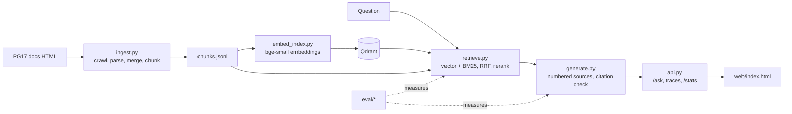

# AskPG

A RAG system over the **PostgreSQL 17 documentation**, built in plain Python (no LangChain / LlamaIndex) and designed to be **measured**, not just demoed: hybrid retrieval, cross-encoder reranking, cited answers, an LLM-judged evaluation, a closed-book baseline, per-request tracing, a local regression gate and a Docker Compose setup with GPU inference.

> Status (15 Oct 2026): retrieval, generation, evaluation, API, frontend and Docker packaging work and are measured. This is a portfolio project, not a production deployment. See [Status](#status) and [Limitations](#limitations).

## What the measurements say

All numbers come from a 30-question dev set (21 answerable, 9 unanswerable). With 21 answerable questions, **one question = 4.8 points**, so differences under about two questions are noise. Details and every run are in [`experiments.md`](experiments.md).

### Retrieval (labels d3, index v3: 1127 pages, 6489 chunks)

| mode | success@1 | success@5 | success@10 | MRR | p50 latency (local) |
|---|---|---|---|---|---|
| vector (bge-small) | 0.476 | 0.810 | 0.905 | 0.616 | 34 ms |
| bm25 | 0.429 | 0.667 | 0.857 | 0.537 | 0.2 ms |
| hybrid (RRF) | 0.476 | 0.714 | 0.952 | 0.586 | 37 ms |
| hybrid + rerank (bge-reranker-base) | 0.619 | 0.810 | 0.905 | 0.695 | 1215 ms |

- The reranker is a **precision** gain (rank-1 hits 13 vs 10, MRR 0.695 vs 0.616), not a recall gain (success@5 is 17/21 for both), at about 33x hybrid's latency. The rank-1 difference is 3 questions: close to the noise boundary.
- Hybrid is **not** better than vector at @5 here (0.714 vs 0.810); it is better at @10.
- Labels moved the metrics more than the code did (labels were widened twice after seeing results; this favours the reranker and is disclosed in the log).

### Generation (g1: hybrid_rerank, k=5, openai/gpt-oss-20b, temperature 0)

| | result |
|---|---|
| answerable questions answered with well-formed citations | 20 / 21 (the one refusal is a retrieval failure) |
| unanswerable questions refused | 9 / 9, including 7 near-misses (MySQL replication, SQL Server, Kubernetes ...) |
| claims supported by the sources the model was shown | 89 / 109 (0.817), judged by a different model |
| answer time p50 / p95 | 9.6 s / 26.7 s (the hosted LLM is about 85% of it) |

- "Supported" means grounded in the retrieved chunks, not "true". The judge is one model, not reproducible at temperature 0. I audited 79 of its claims by hand (one reader, a sample enriched with flagged claims): it agreed with my reading on 81-91% of them and misses direction and qualifier errors (for example "ancestor" vs "descendant").
- For three multi-part questions (multi-01, multi-04, multi-05) the needed section was not in the prompt, yet the model answered without saying what the sources did not cover.
- A deterministic check of the prompt rule "include a snippet only if a source contains it" found a non-verbatim snippet in 7 of 20 answers (a count, not an error rate). One was materially wrong in my reading: an invented `CREATE VIEW ... SECURITY BARRIER` form.

### Closed-book baseline (cb1: same model, same questions, no retrieval)

| | g1 (retrieval) | cb1 (closed book) |
|---|---|---|
| correctness vs reference, 19 questions both answered | 17 correct / 2 partial | 17 correct / 2 partial |
| unanswerable refused | 9 / 9 | 5 / 9 |

**On this dataset retrieval does not buy measurable correctness over a strong closed-book model. It buys verifiability (citations, a grounding check) and safer refusal**, at roughly 8x the input tokens (a lower bound). Likely reasons, both untested: a 20B model has seen the public PostgreSQL docs, and the dev set is too easy. A harder set (PostgreSQL 17-specific details, rarely-read parameters) is the next step.

### Deployment finding: the container ran inference on CPU

The first Docker image installed CPU-only PyTorch, so the reranker ran on CPU inside the container (median about 14.1 s per request, against about 1.2 s on the GPU outside Docker). A separate `pytorch/pytorch` container with `--gpus all` showed that GPU passthrough worked, which isolated the cause to the image. The fix has two parts: CUDA PyTorch (2.5.1+cu124) in the Dockerfile and a GPU reservation in `docker-compose.yml`.

| | CPU container | GPU container |
|---|---|---|
| reranker p50 | 14.1 s | 1.4 s |
| image size | 2.64 GB | 7.14 GB (5.74 GB pip layer, 1.27 GB baked models) |

Caveats: small samples (a handful of requests per window), and one rerank of about 14.7 s appeared among the first five GPU requests. I have not explained it (first-request warmup is a hypothesis, not tested). The retrieval baseline was produced with torch 2.10.0+cu128 outside Docker; the container uses 2.5.1+cu124, so float noise can flip a near-tie. The local gate remains the authority for retrieval quality.

## Architecture



## Design decisions

| Decision | Choice | Why |
|---|---|---|
| Framework | Plain Python | every step is visible and explainable |
| Embedder | `BAAI/bge-small-en-v1.5`, fp32, query-side instruction only | small and fast; runs on a 6 GB GPU or CPU |
| Chunk budget | counted with the embedder's own tokenizer: 400 tokens, 60 overlap | counting with a different tokenizer silently truncated 1.4% of chunks (83 of 6008, v0 index) |
| Small sections | merged into a neighbour, not dropped | dropping them removed real content (syntax, parameters) |
| Provenance | each chunk lists every section it covers (`covers`) | lets the eval map a gold section to the chunk that holds it |
| Keyword search | bm25s, snake_case identifiers kept whole, no stemming | the docs are full of exact identifiers (`work_mem`) |
| Fusion | Reciprocal Rank Fusion over 50 + 50 candidates | no score normalisation needed |
| Reranker | `BAAI/bge-reranker-base` on the top 30 fused candidates | measured: a precision gain |
| Citations | exact refusal sentence or at least one valid `[n]`; one corrective retry | checks well-formedness only, not that the source supports the claim |
| Refusal | the LLM alone, no retrieval-score gate | scores do not separate unanswerable questions; the LLM refused 9/9 |
| Serving | FastAPI, ONE worker, a lock around the pipeline | the models and the LLM throttle keep in-process state; queue wait is traced |
| Gold labels | page + section heading (or anchor), never chunk id | chunk ids change whenever chunking changes |

## Quickstart with Docker Compose (needs an NVIDIA GPU)

Requirements: Docker Desktop with NVIDIA GPU passthrough (the container uses CUDA PyTorch), and a `.env` in the repo root with `LLM_BASE_URL`, `LLM_API_KEY` and `LLM_MODEL` (any OpenAI-compatible endpoint; copy `.env.example`; `.env` is git-ignored and never copied into the image). Stop any local `uvicorn` first: port 8000 and the GPU memory must be free.

```
docker compose build
docker compose up -d
```

Open http://localhost:8000/. Compose starts Qdrant (port not published), a one-shot indexer and the app. The indexer rebuilds the index only if the point count differs from `chunks.jsonl`; the app starts after it finishes. A first index on CPU ran at about 7 chunks/s (roughly 15 minutes); on GPU I expect about 80 s, as on the host, but have not measured it inside the container. `docker compose down -v` deletes the index volume: do not use it casually.

There is no CPU-only image. A hosted CPU deployment would need a separate build (for example a build argument selecting the torch variant) and would be slow in the reranker.

## Quickstart without Docker (Windows, Command Prompt)

Tested on Windows with Python 3.10 and a GTX 1660 Ti (CPU also works, slowly). Paths use `E:\Projects\AskPG`; adjust to yours.

```
pip install requests beautifulsoup4 transformers sentence-transformers qdrant-client numpy bm25s openai python-dotenv fastapi uvicorn
docker run -d --name qdrant -p 6333:6333 -v "%cd%/qdrant_storage:/qdrant/storage" qdrant/qdrant:v1.19.1
python src/ingest.py download
python src/ingest.py chunk
python src/embed_index.py index --recreate
uvicorn api:app --app-dir src --port 8000
```

Endpoints: `POST /ask`, `GET /health`, `GET /stats`.

## Testing and gating

```
pip install pytest
python -m pytest tests -q                      # 29 unit tests; also run by GitHub Actions
python eval\gate_retrieval.py                  # LOCAL retrieval regression gate (needs Qdrant and the index)
python eval\run_eval.py run --name <label> --retriever hybrid_rerank
python eval\run_gen_eval.py --name <label>     # end-to-end generation run (calls the hosted LLM)
python eval\judge.py <label>                   # LLM judge on a saved run
```

The retrieval gate re-runs the eval on the current code and fails if success@5 drops by more than one question or MRR by more than 0.03 (tolerances are my choice, not measured). It aborts if the baseline is stale (chunk count or label counts changed). I broke the pipeline on purpose once: the gate failed at 13/21 success@5 against 17/21 in the baseline, and after restoring the code it reproduced the d3 baseline exactly. CI runs only the corpus-free unit tests; the gate needs the gitignored data, a GPU and a built index, so it stays local.

## Repo layout

```
src/        ingest, embed_index, retrieve, generate, tracing, api
web/        single-page frontend
eval/       dataset.jsonl, run_eval, gate_retrieval, run_gen_eval, run_closed_book, judge, snippet_check, smoke_api ...
tests/      unit tests (no model, no Qdrant, no network)
scripts/    make_requirements, ensure_index
Dockerfile, docker-compose.yml, requirements.txt
experiments.md   every run, with numbers
```

## Status

| Component | State |
|---|---|
| Crawler, parser, chunker (v3) | done, verified |
| Embedding + Qdrant index | done |
| Vector, BM25, hybrid, hybrid + rerank | done, measured |
| Generation with citation check | done, measured (g1) |
| LLM judge, snippet check, closed-book baseline | done, run once each |
| API + frontend + tracing | done; 503 path (Qdrant down) tested and recovers; 502 path (LLM error) with a real provider error not yet tested |
| Unit tests + CI | 29 tests pass locally; GitHub Actions workflow in place |
| Docker packaging | built; GPU inference verified in the container; CPU-only image not provided |
| Concurrency test | not done |
| Larger, harder dataset with a held-out test split | not started |

## Limitations

- **Small dev set.** 21 answerable questions: differences between retrieval modes are mostly within noise, and the closed-book result suggests the set is too easy.
- **Labels were widened after seeing results** (d2, d3), which favours the reranker. Dev-set relabelling is closed.
- **Section-level matching.** A hit means a chunk of the right section was retrieved, not the exact chunk with the answer; a retriever that finds a different valid source is penalised.
- **Citations are checked for form, not truth.** A well-formed citation can point to a chunk that does not support the sentence.
- **The judge is an instrument, not ground truth** (single model, not reproducible, 81-91% agreement with one reader on an enriched sample). Correctness vs the reference is lenient, so report grounding and correctness together.
- **Reranker truncation.** The reranker reads at most 512 tokens and cuts the end of long chunks; 2.5% of chunks are exposed. It caused one visible failure (the COMMENT question is refused). Diagnosed, not fixed.
- **Vocabulary gaps** (for example "SQL dump" vs `pg_dump`) are a retrieval problem; query decomposition does not fix them.
- **Refusal rests on the LLM.** It refused 9/9 here, with one model, one run, n=9.
- **Hosted LLM:** latency from about 2 s to 32 s in g1; one cb1 call took 130 s (probably a client timeout plus retry, a guess); the client timeout is 120 s with 2 retries, so a hung call can take several minutes.
- **Anchors are per section**, not per parameter: a `work_mem` citation links to the whole "Memory" section.
- **One worker and a lock.** Concurrent requests queue (the wait is traced, not yet load-tested). Scaling out would need a separate retrieval service.
- **Traces store user questions.** A public deployment needs a retention policy (not decided).
- **Latency numbers:** retrieval figures are local, single process, warm, on a GTX 1660 Ti; container figures come from a few requests. Local and container runs use different torch versions.

## Data and licensing

Documentation content is from the PostgreSQL project. The crawler is polite (identifies itself, rate-limited, caches pages) and intended for educational use. Check the PostgreSQL documentation license before redistributing any crawled content.